# Assembly

In order. Parts are in [BOM.md](BOM.md); wiring is in [WIRING.md](WIRING.md) and must be followed exactly. Nothing here has been built yet, so expect to adjust.

The pictures are the model built up to each step (`part="assembly"`, `step=N`). **Orange** is what that step adds, pulled out of its place (red for its wiring); green is ASA, dark grey PETG, and see-through grey is bought hardware already fitted (projector, ball head, brick, AC cord, PIR, Pi and HAT). Regenerate them with `scripts/render_assembly.sh` after a model change.

## 1. Fit coupon

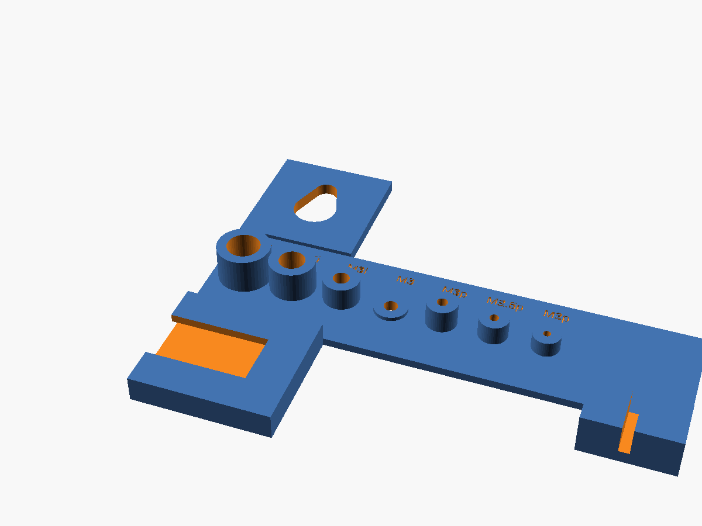

1. Print `fit_coupon` first.
2. Press in each heat-set insert and drive each screw into its pilot.
3. Hang the keyhole on an M5 bolt and lift it off again.
4. Slide the frame glazing into its slot.
5. Slide the ball head's hot-shoe adapter into the T-slot and tighten its ring.
6. Adjust `insert_d`, `stud_insert_d`, `m3_insert_d`, `clearance` and so on in the SCAD until everything fits, then export the rest. [PRINTING.md](PRINTING.md), "Fit coupon", says how to test each feature and which parameter to change.

## 2. Clean up the prints

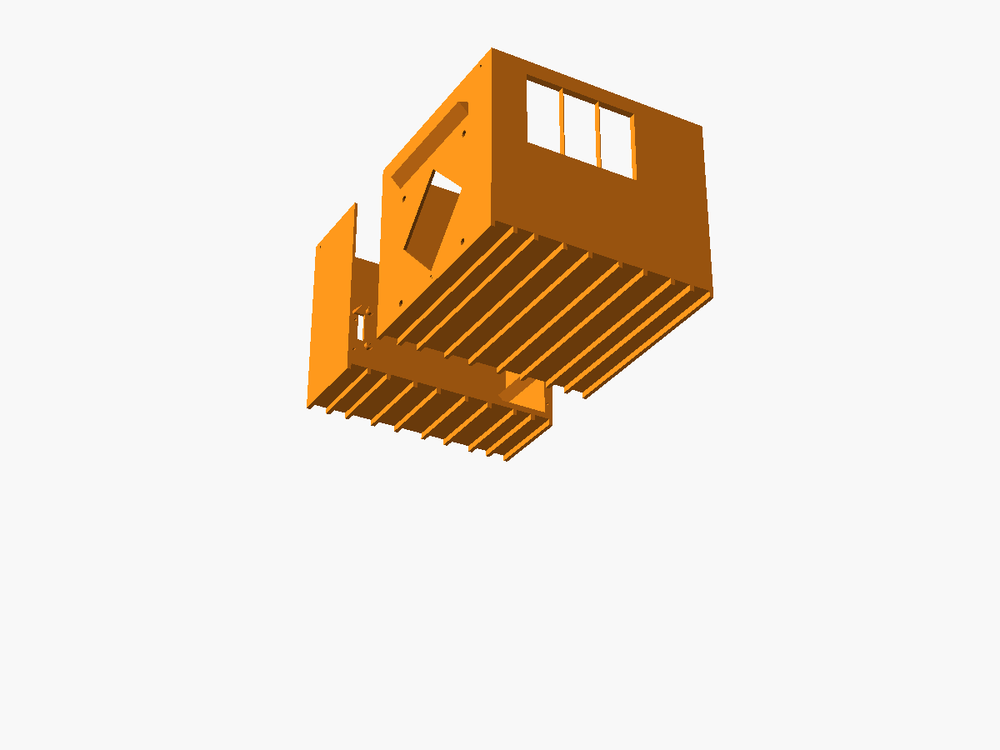

1. Snap out the two thin ribs in the window opening.
2. From under each base tile, punch out the thin skin closing the floor holes (`hole_skin`): the drains (4 mm drill bit), the speaker-wire chimney and the stake bores. Check each is open from the floor through to the gap underneath.
3. Mask the window rebate, insert holes and screw holes, then spray the inside of both base halves and the lid matte black.

## 3. Heat-set inserts

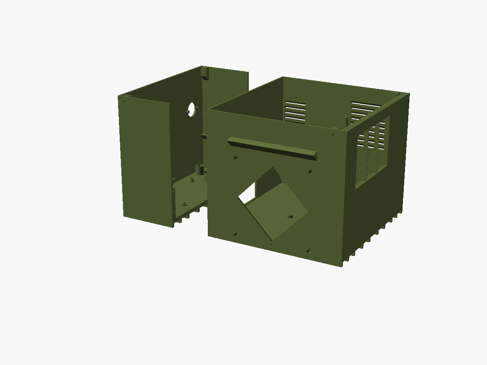

1. `base_front`: 4x M5 in the hatch studs, from outside (the four holes round the diamond).
2. `base_rear`: 1x M3 for the sled thumbscrew.

## 4. Screens

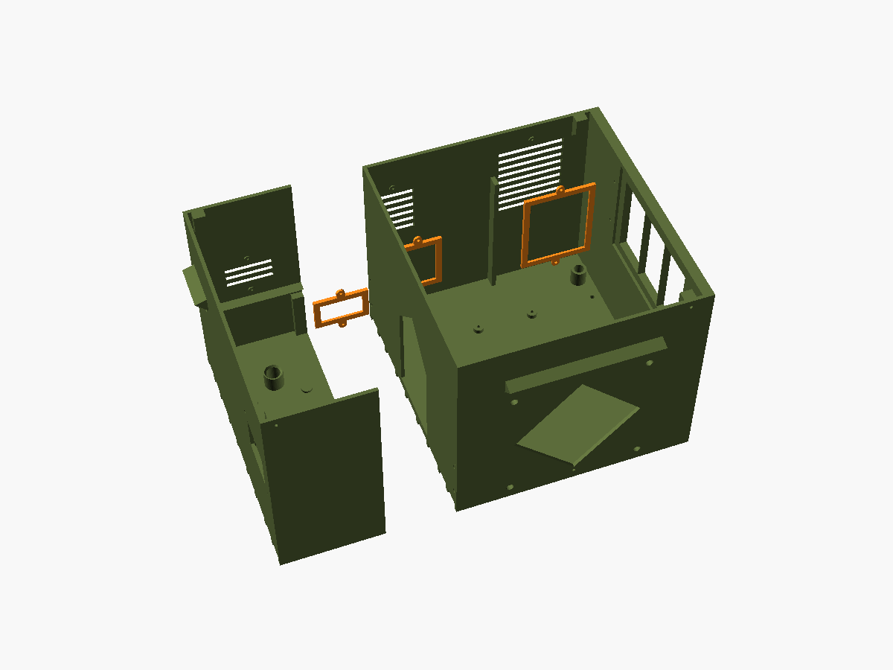

1. Glue insect screen inside the three caps (`exhaust_cap`, `intake_cap`, `vent_cap`).
2. Screw each over its right-wall louver bank from inside, 2x M2: front bank `exhaust_cap`, rear bank `intake_cap`, the high bank over the shelf `vent_cap`.

## 5. Join the base

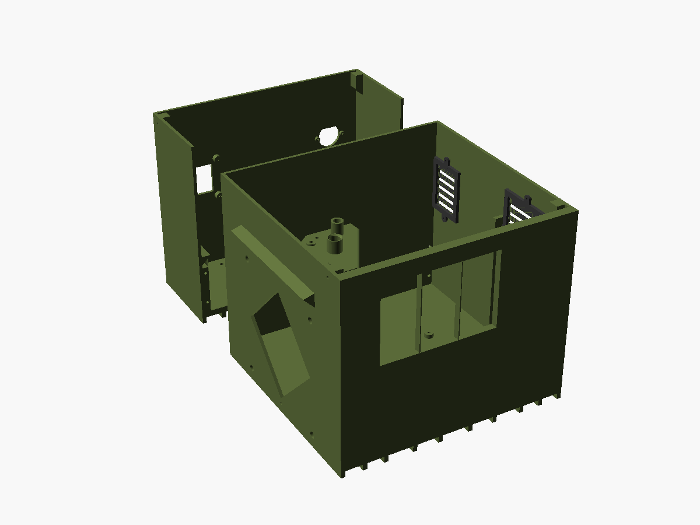

1. Silicone the joint faces.
2. Push the halves together.
3. Drive 4x M3 x 12 from the projector side through the divider into the rear half's collars.
4. Wipe off the squeeze-out.

## 6. Window

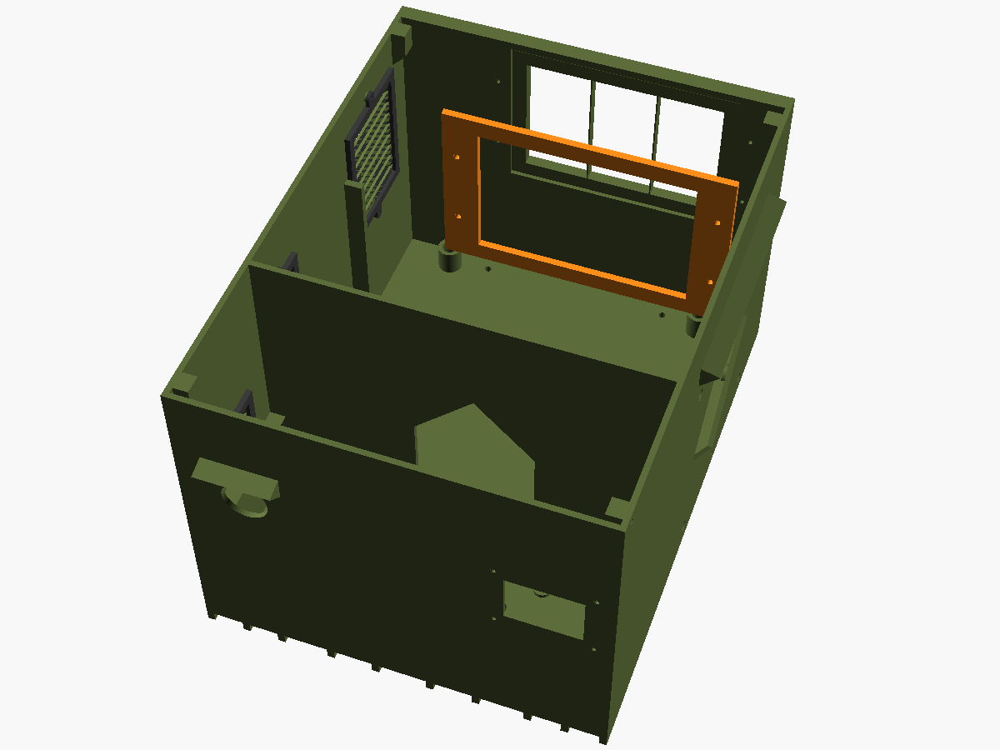

1. Run a thin bead of silicone round the rebate.
2. Press the pane in from inside.
3. Screw the `window_frame` over it (4x M3 x 8).

## 7. PIR

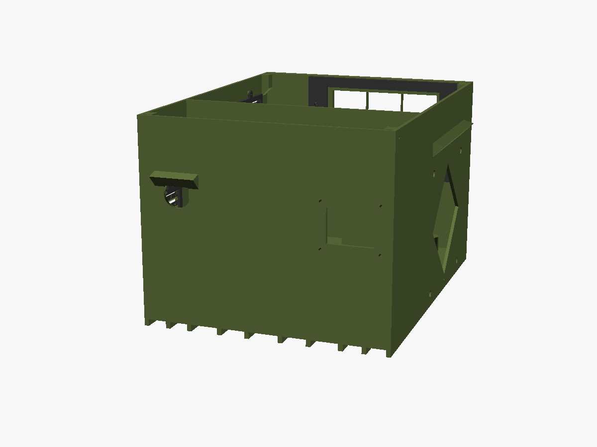

1. Push the dome through the rear-wall hole (under the hood) from inside.
2. Screw the board on (2x M2).
3. Seal round the dome outside with silicone.

## 8. Projector mount

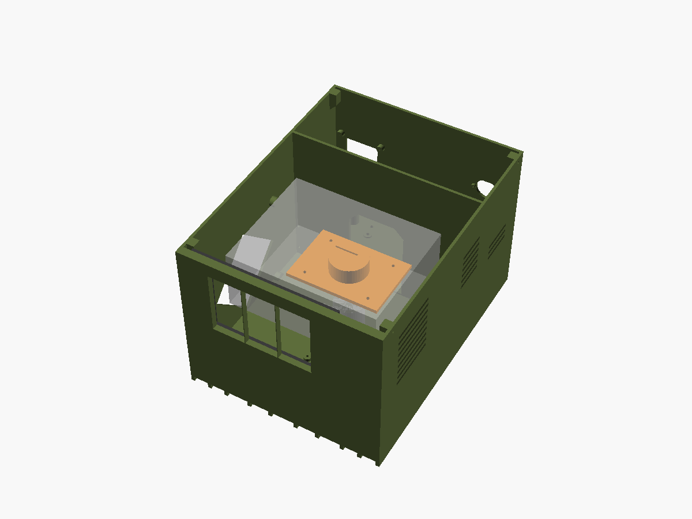

1. Screw the `pedestal` to the floor (4x M3 x 10).
2. Screw the ball head onto its hot-shoe adapter, slide the adapter into the pedestal's T-slot from the left (hatch) side until it stops, and tighten the adapter's ring on the lips.
3. Mount the projector on the ball head.
4. Fit the right-angle HDMI plug in the right-face I/O strip, cable pointing rearward.
5. Fit the right-angle 5.5 x 2.5 mm adapter in the DC jack at the rear top-right corner, pointing back, above the intake.
6. If BRINGUP row 4a passed, plug the Y-splitter's leg 1 into it; if it failed, fit the buck converter first (WIRING.md); otherwise leave leg 1 unplugged.
7. If the IR fallback is built: stick the `ir_holder` (LED in it) on the projector's front face above the Tkisko logo, about 35 mm right of centre and 50 mm above the underside, body pointing toward the window. Run the IR LED lead up and back over the projector's top, held with tape, then through the right side gap past the baffle to the Pi.

## 9. Power

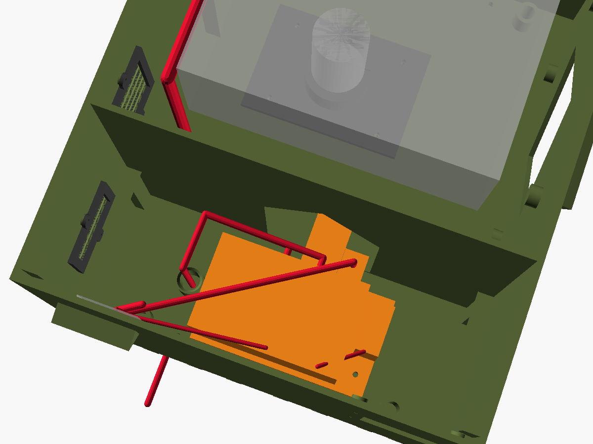

Note: the shipped provisional brick layout cannot be assembled (the brick sits across the cord opening); re-fit the shelf after BRINGUP row 4.

1. Lid off, projector aside if needed.
2. Seat the shelf on its ledges and lay the brick on it toward the rear wall, under the velcro strap.
3. Pass the AC cord's connector in through the opening in the rear wall and plug it fully into the brick's inlet.
4. Close the `cord_clamp` over its foam gasket (4x M3 x 16 self-tapping into the wall bosses) and pull-test it (BRINGUP row 17a).
5. Leave a drip loop outside, below the clamp.
6. Plug the brick's DC cord into the Y-splitter and meter both legs (centre +) before connecting anything.
7. If the relay fallback is built, cut leg 1 and splice the relay as in WIRING.md.

## 10. Pi sled

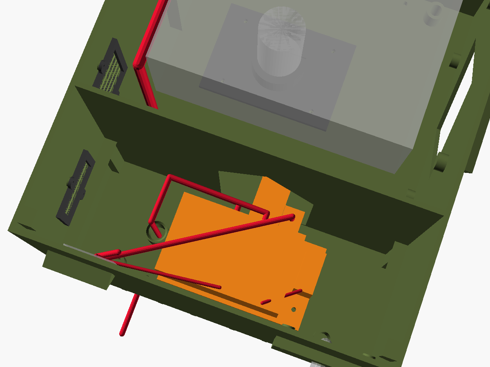

Red is the wiring, as routed below: HDMI forward through the divider, across the rear gap and up the right side gap to the projector; leg 2 and the PIR leads down the shelf's wire slot to the HAT; the fan lead; speaker wire down the chimney. The DigiAMP+'s barrel jack and speaker terminals are on its edge facing the divider (from the product photo), so leg 2 goes in through a right-angle adapter.

1. Mount the Pi on its sled (4x M2.5).
2. On a Pi 3 or 4, stick the heatsink on the SoC, then screw the fan to the sled's upright plate (4x M2.5 x 16, nuts on the fan side), label facing the Pi so it blows into the gap under the HAT.
3. Fit the DigiAMP+ (a Zero 2 W needs a 40-pin header soldered first).
4. Plug the GPIO leads (PIR, the fan's switch, and the relay and IR LED only if built) into the DigiAMP+'s pass-through header per [pi/docs/wiring.md](../pi/docs/wiring.md).
5. Set the sled on its pins and fit the thumbscrew.
6. Plug the HDMI cable into the Pi straight through the low part of the divider pass-through (there is no room for the plug behind the divider). Route the cable from there along the side gap above the baffle to the right-face I/O strip, and check BRINGUP row 21 (the cable crossing the rear gap at full tilt and pan).
7. Put a right-angle adapter (a second one from the 5-pack) in the DigiAMP+'s barrel jack, turned up: the jack faces the divider about 15 mm away, inside the pass-through. Plug the Y-splitter's leg 2 into it.
8. Screw the speaker wire into the two terminal blocks on the same edge, run it round the USB end of the Pi, feed it down the chimney and plug the chimney round the wires with foam.

## 11. First power-up

Follow the checklist at the end of [WIRING.md](WIRING.md) before closing anything.

## 12. Lid

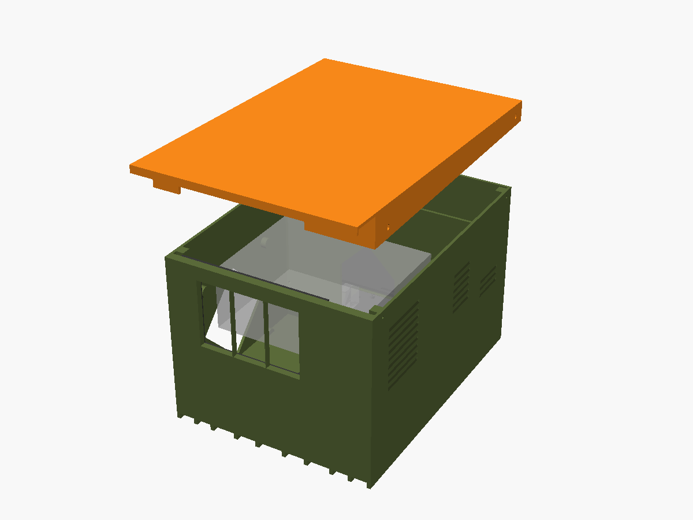

1. Stick 2 mm foam round the base rim.
2. Set the lid on and press it down onto the foam.
3. Drive the 4 side screws through the skirt slots.

## 13. Hatch

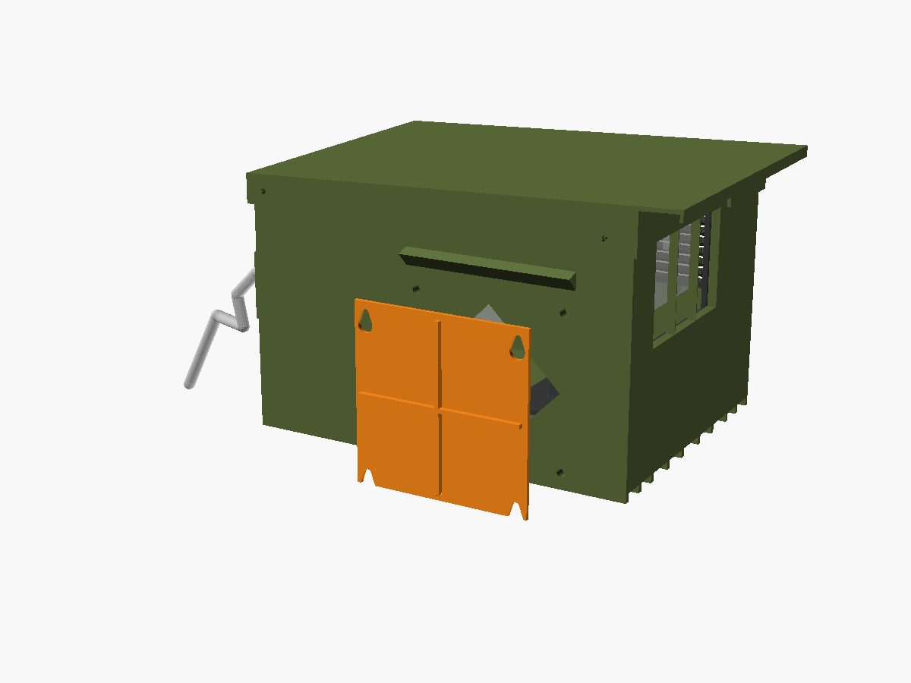

1. Stick 1.5 mm foam round the hatch opening on the cover.
2. Hang the cover on its keyholes (narrow end up) and let it drop onto the M5 bolts.

## 14. Software and aiming

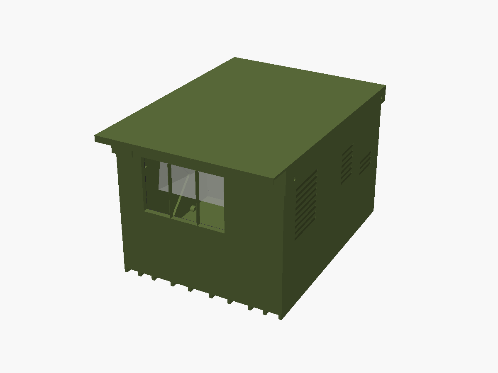

1. Flash and pair the Pi ([install](../pi/docs/install.md), [Apple Home](../pi/docs/apple-home.md)).
2. Place, stake and aim ([AIMING.md](AIMING.md)).
